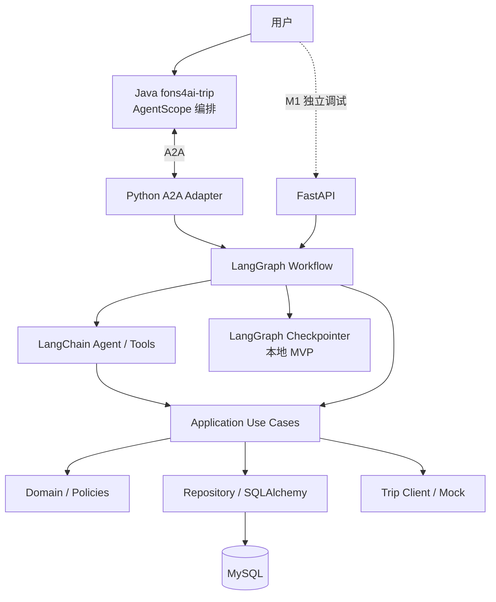

# 技术架构与模块职责

## 逻辑关系



## 目录建议

```text
src/reimbursement/
├── main.py
├── api/             # REST 路由与 Pydantic 请求/响应
├── a2a/             # Agent Card、Executor、Task 事件适配
├── agents/          # LangChain agent、tool、prompt
├── graph/           # state、nodes、workflow
├── application/     # 用例、事务编排、业务授权
├── domain/          # 实体、枚举、值对象、纯规则
└── infrastructure/  # MySQL ORM、仓储、Trip Mock、checkpoint
```

## 关键决策

- **模块化单体**：保留分层，但不要分布式拆分和额外抽象框架。
- **MySQL**：保存报销业务实体；不用于自动保存所有 Agent 消息。
- **Checkpointer**：MVP 单实例使用 InMemorySaver（服务重启会丢）；如需真实重启恢复，另行增加 SQLite/Postgres Checkpointer，不将此能力误称已完成。
- **确认授权**：服务端生成与订单版本、金额绑定的确认凭证；用户通过可信交互明确确认后才能提交。不得只依赖 Prompt。
- **A2A**：对接 Python A2A Server，Java 侧能力需核验；跨协议传播用户身份需签名或受控可信通道。
- **风险**：Java 侧 A2A 适配可能超出 Day 8 预算，先保证标准 A2A Client 对 Python Server 的调用验收。

## 接口建议（非最终规范）

- `GET /health`
- `POST /api/reimbursements/drafts` 创建草稿
- `GET /api/reimbursements/{id}` 查询报销单
- `POST /api/reimbursements/{id}/expenses` 添加费用
- `PATCH /api/reimbursements/{id}/expenses/{expense_id}` 修改费用
- `POST /api/reimbursements/{id}/confirmation` 获取确认摘要及凭证
- `POST /api/reimbursements/{id}/submit` 用户凭证提交
- `POST /api/agent/chat` 本地调试入口

实际 URL 和 DTO 在 Day 1–3 确定，并同步更新本文档与测试。
