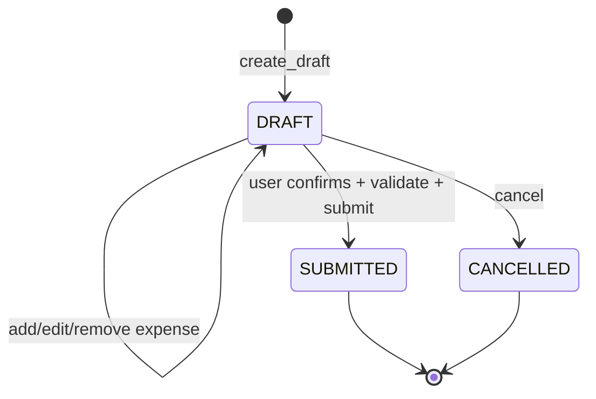

# 领域模型、业务规则和数据库最小设计

## 聚合

`ReimbursementOrder`（聚合根）：order_id、order_no、applicant_id、type、title、trip_source、trip_id、trip_no、currency、total_amount、status、version。

`ExpenseItem`（聚合内实体）：expense_id、order_id、expense_type、expense_date、amount、description。

`Money` 值对象：Decimal amount + currency。`TripReference` 可空值对象：source / id / no。

`ReimbursementPolicy` 领域服务：金额正数、类型合法、费用非空、同币种、提交状态合法。领域模型禁止直接依赖 ORM / LLM。

## 状态转换



- `PENDING_CONFIRMATION` 不是业务状态；等待确认属于 LangGraph/A2A 任务状态。
- 所有变更检查所有者身份和 `version`。提交后普通编辑接口拒绝。
- 提交不包含审核、打款语义。

## MySQL V1 最小表结构

MVP 先用如下两张核心业务表。实现 Day 3 / Day 6 时，根据幂等与确认方案**最少量**添加 `reimbursement_idempotency` 与 `reimbursement_confirmation`（推荐），并用 Alembic 管理迁移。

```sql
CREATE TABLE reimbursement_order (
  id BIGINT PRIMARY KEY AUTO_INCREMENT,
  order_no VARCHAR(40) NOT NULL UNIQUE,
  reimbursement_type VARCHAR(20) NOT NULL,
  title VARCHAR(200) NOT NULL,
  applicant_id VARCHAR(64) NOT NULL,
  trip_source VARCHAR(64) NULL,
  trip_id VARCHAR(64) NULL,
  trip_no VARCHAR(64) NULL,
  currency CHAR(3) NOT NULL DEFAULT 'CNY',
  total_amount DECIMAL(18,2) NOT NULL DEFAULT 0.00,
  status VARCHAR(24) NOT NULL DEFAULT 'DRAFT',
  version INT NOT NULL DEFAULT 0,
  submitted_at DATETIME(3) NULL,
  created_at DATETIME(3) NOT NULL DEFAULT CURRENT_TIMESTAMP(3),
  updated_at DATETIME(3) NOT NULL DEFAULT CURRENT_TIMESTAMP(3) ON UPDATE CURRENT_TIMESTAMP(3),
  INDEX idx_applicant_status (applicant_id, status),
  INDEX idx_trip (trip_source, trip_id),
  CONSTRAINT chk_reimbursement_type CHECK (reimbursement_type IN ('TRAVEL', 'DAILY')),
  CONSTRAINT chk_reimbursement_status CHECK (status IN ('DRAFT', 'SUBMITTED', 'CANCELLED')),
  CONSTRAINT chk_reimbursement_amount CHECK (total_amount >= 0)
) ENGINE=InnoDB;

CREATE TABLE reimbursement_expense (
  id BIGINT PRIMARY KEY AUTO_INCREMENT,
  order_id BIGINT NOT NULL,
  expense_type VARCHAR(32) NOT NULL,
  expense_date DATE NOT NULL,
  amount DECIMAL(18,2) NOT NULL,
  description VARCHAR(500) NULL,
  created_at DATETIME(3) NOT NULL DEFAULT CURRENT_TIMESTAMP(3),
  INDEX idx_order (order_id),
  CONSTRAINT fk_expense_order FOREIGN KEY (order_id) REFERENCES reimbursement_order(id),
  CONSTRAINT chk_expense_amount CHECK (amount > 0)
) ENGINE=InnoDB;
```

## 一致性与幂等

- 添加或修改明细时，锁定/乐观校验报销单版本、更新费用、聚合重算 `total_amount`，事务原子提交。
- 对创建草稿和提交定义稳定 idempotency key；同键同请求返回既有结果，不同请求 hash 必须冲突。
- 确认凭证绑定 `order_id + applicant_id + version + total_amount + expires_at`，服务端保存/签名并一次性消费；草稿更新会使旧确认失效。
- Checkpoint 不是数据库事务的一部分，节点重放可造成副作用，所有业务写入口必须幂等。
- 正式环境应完善审计、鉴权、文件存储和数据脱敏；不属于 30 小时 MVP。
