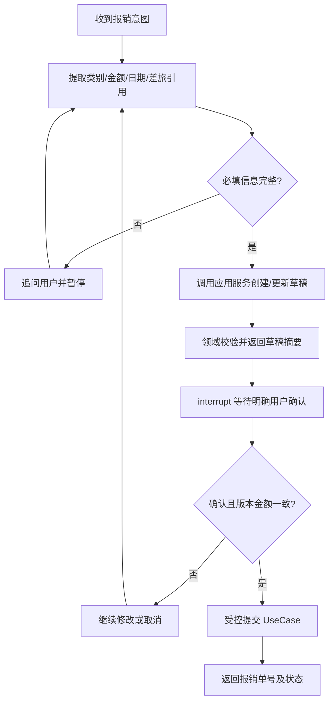

# Agent 工作流与 A2A 交互规范

## 工作流（MVP）

## LangChain 职责

- LLM：意图理解、提取字段、生成友好追问与摘要。
- Tool：`get_trip_info`（MVP Mock）、`create_draft`、`get_order`、`add_expense`、`update_expense`、`validate_draft`。
- `submit` 不作为无条件可调用工具；必须由有确认凭证的可信应用服务执行。
- Tool 参数使用 Pydantic 进行类型检查；金额原始输入需解析并转 `Decimal`。

## LangGraph 状态字段建议

`thread_id`, `request_id`, `applicant_id`（可信上下文）, `reimbursement_type`, `trip_reference`, `order_id`, `missing_fields`, `draft_version`, `draft_total`, `messages`, `confirmation_status`。

业务真相以 MySQL 为准，State 只保存引用和执行上下文，不复制完整报销数据。

## HITL 注意事项

- `interrupt()` 将任务暂停，需要 Checkpointer 和稳定 `thread_id`；恢复用 `Command(resume=...)`。
- 中断节点在恢复时可能从头重跑；避免在同一中断节点之前执行非幂等写库。将“保存草稿”和“等待确认”分成不同节点。
- M2 使用本地 Checkpointer 验证单实例会话内恢复，**不承诺进程重启恢复**。
- 用户确认的是呈现过的具体报销单版本与总金额；不得由模型凭空生成授权标志。

## A2A 映射与边界

- Python 对外发布 Agent Card，采用当前兼容的官方 A2A SDK 实现 Task Executor。
- `working` ← Graph 执行中；`input-required` ← 需要外部输入/确认；`completed` ← 完成；`failed` ← 失败。
- 需要保存 A2A `contextId`、`taskId` 与 LangGraph `thread_id`、业务 `order_id` 的映射（可以先由内存保持；重启恢复不属于 MVP）。
- Java 主 Agent 只看到远程报销 Agent 能力，不能直接看到 Python 内部全部 Tools。
- Java A2A 能力未源码核验，先使用标准 A2A Client 测 Python，后完成 Java 适配。

## 交互契约（示意）

输入：`报销上周上海出差的高铁费 560 元，住宿 800 元，关联差旅单 T001`。

输出草稿：`order_no`、`type`、`items`、`total_amount`、`status=DRAFT`、`next_action=CONFIRM`。

收到明确确认时，应用层校验授权和当前草稿版本，再将状态改为 `SUBMITTED`。
